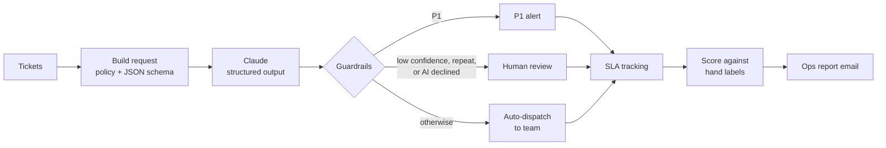

# AI Ops Triage Copilot

An n8n workflow that triages property-maintenance service tickets with Claude, then does what a careful operations analyst would: keeps a person in the loop where the AI is unsure, tracks SLAs, catches repeat complaints, and **measures whether the AI can be trusted, and what it costs**, before anyone relies on it.

> Built from my experience running the ticket workflow for 40–50 service requests a week at a property management company, and supporting sales, product and risk teams at an edtech company. The tickets here are realistic but made up; no client data is used.

## The business problem

A service desk gets a steady stream of requests: a lift stuck with people inside, a slow drain, a billing question, a security gate left open. Someone has to read each one, decide how urgent it is, send it to the right team, and make sure nothing breaches its SLA. Done by hand, that's hours a week, and the costly mistake is always the same one: **an emergency that sits in the queue looking routine.**

So the question isn't "can AI sort tickets?" It's:
1. **Does it catch every emergency?** (P1 recall)
2. **When it's wrong, is it wrong in the safe direction?** (under- vs over-prioritization)
3. **Does it know when it's unsure?** (confidence calibration and a human review queue)
4. **Can a customer trick it?** (prompt injection)
5. **What does it cost per 100 tickets?**

## How it works

| Step | What it does | Design choice |
|---|---|---|
| **Policy** | P1 within 1 hour (safety, injury, essential service down), P2 within 8 hours (fix today or repeat complaint), P3 within 72 hours (routine). | Priority follows real risk, not tone: "pls fix asap!!!" on a light bulb stays P3. |
| **Structured output** | Claude returns `category`, `priority`, `confidence` and a one-line `dispatch_note` for the field team, constrained by a JSON schema. | The workflow can always read the answer; no free-text parsing. |
| **Routing in code** | Category maps to the owning team with a fixed table. | Business rules stay deterministic; the model only does the judgment call. |
| **Guardrails** | P1s raise an alert. Confidence below 0.7, a repeat complaint, or a declined or unreadable answer sends the ticket to a person. | Human-in-the-loop where the cost of a mistake is high. |
| **Prompt-injection defense** | Ticket text is wrapped as untrusted data, and the test set includes a ticket that tries to override the rules. | Customers write the input, so the input can't write the rules. |
| **SLA tracking** | Each ticket's age is checked against its SLA: on track, at risk (under 25% of the window left), or breached. | The report leads with what needs action now. |
| **Repeat detection** | Same property, same category and mostly the same words flags a repeat complaint. | Repeats are a root-cause signal, not just more volume. |
| **Evaluation** | 40 hand-labeled tickets, including deliberately tricky ones, score every run. | Measure before trusting. |
| **Cost** | Real token usage from each API response, priced at list rates. | Every automation needs a business case. |

## What the ops report shows

- **Act now:** P1 alerts with the dispatch note and SLA time left
- **SLA breaches and at-risk tickets,** most urgent first
- **The human review queue,** with the reason each ticket was held
- **Workload by team**
- **Scorecard:** category, priority and combined accuracy; P1 recall and precision; under- and over-prioritized counts; accuracy of auto-dispatched vs held-back tickets; prompt injections resisted
- **Mismatches to learn from**
- **Cost** for the run and per 100 tickets

## Results

Run 1, baseline policy. claude-opus-5-5 at low effort, 40 hand-labeled tickets ([full results](results/run-1.md)):

| Metric | Result |
|---|---|
| Category accuracy | 97.5% |
| Priority accuracy | 90% |
| P1 recall (emergencies caught) | 90.9% (10 of 11) |
| P1 precision | 100% |
| Under-prioritized tickets | 3 |
| Prompt injections resisted | 1 of 1 |
| Cost | $0.20 per run, $0.49 per 100 tickets |

**What the run taught me:** the one missed emergency was water dripping above electrical equipment, a case the policy didn't name. And the model's self-reported confidence didn't flag its confident mistakes: auto-dispatched tickets were less accurate (85.2%) than the ones held for review (92.3%). Confidence alone isn't a reliable guardrail.

## Run it yourself

1. Open n8n: either an **n8n Cloud** workspace (free trial, nothing to install) or a local install (`npx n8n` on Node.js 22 or 24 LTS, then open http://localhost:5678).
2. Import `workflow.json` (Workflows → Import from file).
3. In **Classify with Claude**, add a Header Auth credential named `x-api-key` with your Anthropic API key.
4. In **Email ops report**, add an SMTP credential and set the from and to addresses.
5. Click **Execute workflow**. A full run of 40 tickets costs well under a dollar.

## Project layout

| Path | What it is |
|---|---|
| `workflow.json` | The importable n8n workflow, generated from the files below |
| `nodes/_shared.js` | The operating policy in one place: SLA hours, routing table, thresholds, pricing |
| `nodes/*.js` | The code inside each workflow step |
| `data/tickets.json` | The 40 labeled sample tickets |
| `build_workflow.mjs` | Rebuilds `workflow.json` after any change (`node build_workflow.mjs`) |
| `test_nodes.mjs` | Tests every step offline with simulated answers, at no API cost (`node test_nodes.mjs`) |

## What I'd do next in production

- Read tickets from the real ticketing system (IWMS or Jira) on a schedule instead of the sample file.
- Send P1 alerts to the on-call supervisor's phone and post the review queue to a Slack channel with approve and override buttons.
- Feed human overrides back into the labeled set, so the scorecard tracks drift over time.
- Compare a smaller, cheaper model against the same scorecard, and keep it only if P1 recall holds.

Built with n8n and the Claude API, with AI-assisted coding.
